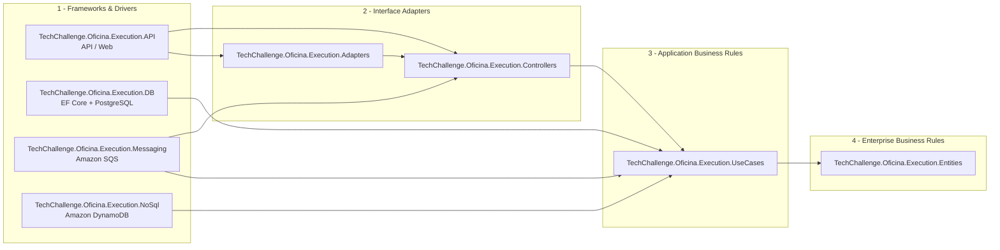
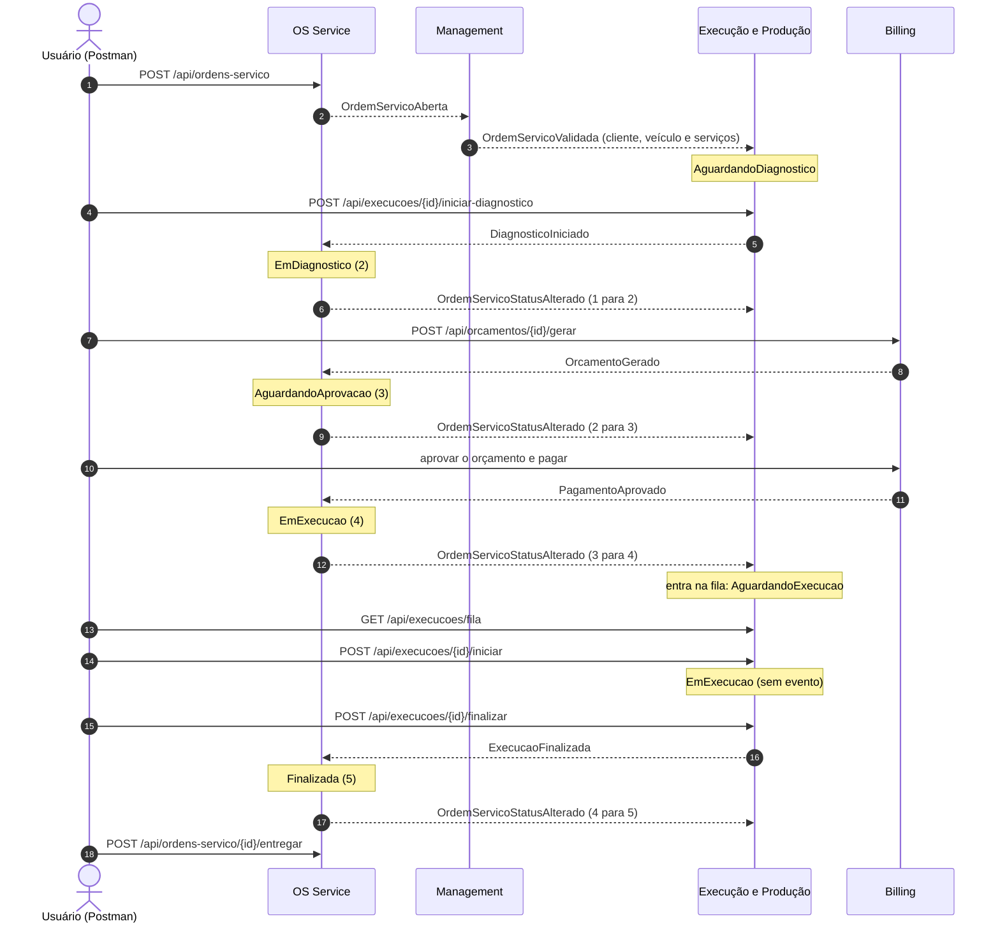
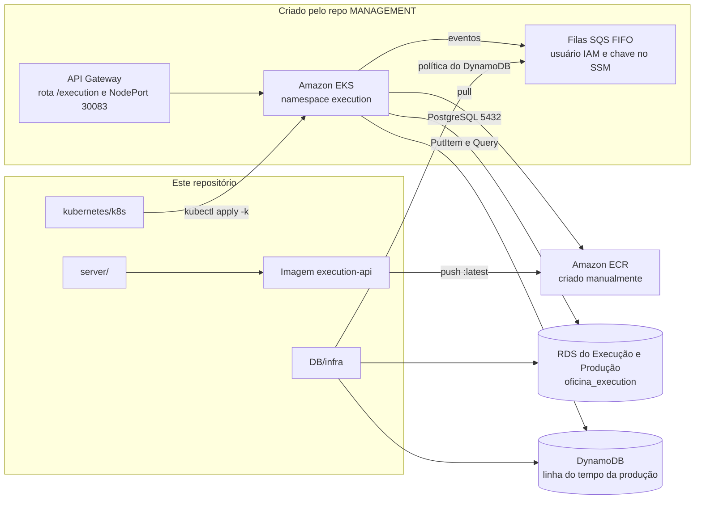

# Projeto Oficina — Execução e Produção

## 1. Identificação

Microsserviço de execução e produção do software de gestão de uma oficina mecânica: a fila de produção da oficina, o diagnóstico e a execução dos serviços.

Tech Challenge da Fase 4 do curso SOAT16 da FIAP. Na fase 4, o diagnóstico e a execução, que eram rotas de status do OS Service, viraram este microsserviço, com banco, namespace no Kubernetes e pipelines próprios ([ADR-023](./docs/adr/ADR-023-Execucao-e-Producao-Fila-de-Execucao-e-Status-por-Eventos.md)).

O sistema tem cinco repositórios:
- **EXECUTION** (este): a fila de produção, o início do diagnóstico e o início e a finalização da execução. Avisa o OS Service por eventos; não muda o status da OS.
- [OS-SERVICE](https://github.com/GuiToniello/tech-challenge-fase-4-OS-SERVICE-soat16-rm374658): ciclo de vida da OS (abertura, atualização, exclusão, consultas, histórico, entrega e indicadores). É o único que muda o status da OS.
- [BILLING](https://github.com/GuiToniello/tech-challenge-fase-4-BILLING-soat16-rm374658): orçamento (gerar, enviar por e-mail, aprovar e recusar) e pagamento pelo Mercado Pago. O pagamento aprovado leva a OS para execução.
- [MANAGEMENT](https://github.com/GuiToniello/tech-challenge-fase-4-MANAGEMENT-soat16-rm374658): cadastros (clientes, veículos, serviços e insumos), estoque, validação da OS e e-mail de mudança de status. Também cria a rede, o cluster EKS, o API Gateway, o Datadog e as filas SQS que este repositório usa.
- [LAMBDA](https://github.com/GuiToniello/tech-challenge-fase-4-LAMBDA-soat16-rm374658): autenticação (Lambda authorizer e `POST /auth/token`).

Os serviços se comunicam só por eventos no Amazon SQS ([ADR-020](https://github.com/GuiToniello/tech-challenge-fase-4-MANAGEMENT-soat16-rm374658/blob/main/docs/adr/ADR-020-Eventos-com-SQS-e-Saga-Coreografada.md)): não há chamadas HTTP entre as APIs, e nenhum serviço lê o banco do outro. Este serviço não tem integrações externas, como o Mercado Pago e o Resend do Billing: usa só o próprio banco, o SQS e uma tabela do Amazon DynamoDB, com a linha do tempo da produção de cada OS ([ADR-025](./docs/adr/ADR-025-Linha-do-Tempo-da-Producao-no-DynamoDB.md)).

Grupo:
-  Guilherme Toniello Vieira -  SOAT16 - rm374658

### 1.1 Estrutura do repositório

```
/
├── server/               Solução .NET: Execução e Produção, camadas da Clean Architecture e testes
├── e2e/                  Collection do Postman (fila de produção) e environment da AWS
├── docker-compose.yml    Postgres + ElasticMQ (SQS local) + DynamoDB Local + Execução e Produção para rodar localmente
├── elasticmq.conf        Filas FIFO do ElasticMQ, as mesmas do SQS na AWS
├── DB/infra/             Terraform do Amazon RDS PostgreSQL e da tabela DynamoDB do Execução e Produção
├── kubernetes/k8s/       Manifests Kubernetes do Execução e Produção (Kustomize)
├── docs/                 ADR-023, ADR-025 e observabilidade
└── .github/workflows/    Pipelines (build, testes, imagem, Terraform do banco e deploy no cluster)
```

| Pasta | O que tem | Documentação |
|---|---|---|
| [server/](./server/) | Código .NET 10 da `TechChallenge.Oficina.Execution.API` e testes | Seções 2 e 3 deste README |
| [e2e/](./e2e/) | Collection do Postman e environment da AWS | Seção 7 |
| [DB/infra/](./DB/infra/) | Amazon RDS PostgreSQL, tabela DynamoDB da linha do tempo da produção e a política IAM dela (state `techchallenge-oficina/fase-4/execution-database.tfstate`) | Seção 5 |
| [kubernetes/k8s/](./kubernetes/k8s/) | Namespace, ConfigMap, Secret, Deployment, Service e HPA do `execution-api` | Seção 5 |
| [docs/](./docs/) | [ADR-023](./docs/adr/ADR-023-Execucao-e-Producao-Fila-de-Execucao-e-Status-por-Eventos.md), [ADR-025](./docs/adr/ADR-025-Linha-do-Tempo-da-Producao-no-DynamoDB.md) e o [contrato de observabilidade](./docs/observabilidade.md) deste serviço | Seção 8 |
| [.github/workflows/](./.github/workflows/) | Bootstrap, Deploy, Destroy e K8s Apply | [.github/workflows/README.md](./.github/workflows/README.md) |

## 2. Arquitetura

A visão geral do sistema (diagrama de componentes e diagramas de sequência, inclusive os do diagnóstico e da execução) está no [docs/arquitetura.md do MANAGEMENT](https://github.com/GuiToniello/tech-challenge-fase-4-MANAGEMENT-soat16-rm374658/blob/main/docs/arquitetura.md).

O código segue a mesma Clean Architecture da Management ([ADR-001](https://github.com/GuiToniello/tech-challenge-fase-4-MANAGEMENT-soat16-rm374658/blob/main/docs/adr/ADR-001-Clean-Architecture.md)), com 4 anéis e as dependências sempre apontando para dentro:



Os padrões são os mesmos da Management: folder-by-feature, Gateways, Commands/Queries/ViewModels (CQS), AutoMapper nos UseCases, EF Core com PostgreSQL e migrations no startup, Swagger, erros em duas camadas e logs JSON com Serilog. O projeto Entities é `netstandard2.1`, e os demais, .NET 10. O AutoMapper está na versão 16.3.0 (os outros repositórios ainda usam a 16.1.1, que gera o alerta de vulnerabilidade `NU1903` no restore). Os casos de uso dependem só de portas, implementadas no anel de fora:

| Porta (UseCases) | Implementação | Para quê |
|---|---|---|
| `IExecucaoGateway` | Projeto `DB` (`ExecucaoGateway`, EF Core) | Gravar e ler os itens da produção e listar a fila |
| `IEventosPublisher` | Projeto `Messaging` (`EventosPublisher`, SDK do SQS) | Publicar `DiagnosticoIniciado` e `ExecucaoFinalizada` na fila do OS Service |
| `IHistoricoExecucaoGateway` | Projeto `NoSql` (`HistoricoExecucaoGateway`, SDK do DynamoDB) | Gravar (*best-effort*) e consultar a linha do tempo da produção ([ADR-025](./docs/adr/ADR-025-Linha-do-Tempo-da-Producao-no-DynamoDB.md)) |

O evento consumido entra pelo [EventosController](./server/2%20-%20Interface%20Adapters/TechChallenge.Oficina.Execution.Controllers/Features/Eventos/EventosController.cs), como uma requisição HTTP entra por um endpoint.

### 2.1 Responsabilidades

| Fica neste serviço | Fica em outro serviço |
|---|---|
| Fila de produção: o que aguarda diagnóstico, está em diagnóstico, aguarda execução ou está em execução | Abrir, atualizar, excluir e consultar a OS, inclusive a lista por prioridade (`/ordenadas`), o acompanhamento com o histórico de status e a lista por cliente (OS Service) |
| Início do diagnóstico, que avisa o OS Service (`DiagnosticoIniciado`) | Mudança de status da OS, a entrega e os indicadores (OS Service). O status muda lá, ao consumir os eventos daqui e do Billing |
| Início da execução: controle interno, só com a data e o log | Orçamento, pagamento e a passagem da OS para `EmExecucao` com o `PagamentoAprovado` (Billing) |
| Finalização da execução, que avisa o OS Service (`ExecucaoFinalizada`) | Cadastros, estoque (debitado no pagamento aprovado), validação da OS e e-mail de mudança de status (Management) |
| Cópia da OS (cliente, veículo, nomes dos serviços e status) e a data de cada passo da produção | |
| Linha do tempo da produção de cada OS no DynamoDB, complementar às datas gravadas no PostgreSQL | Os outros históricos no DynamoDB, cada um na própria tabela: os eventos de pagamento (Billing), a saga (OS Service) e as movimentações de estoque (Management) |

Este serviço não muda o status da OS e não guarda cadastros nem preços. Os dados da OS chegam no `OrdemServicoValidada` (Management), e o status, no `OrdemServicoStatusAlterado` (OS Service). As rotas de status da oficina que ficavam no OS Service (`/em-diagnostico`, `/em-execucao` e `/finalizar`) foram removidas de lá: o diagnóstico e a finalização passaram para cá, e a execução só começa com o pagamento aprovado.

### 2.2 Rotas

As rotas ficam na raiz da API. Na AWS, ganham o prefixo `/execution` do API Gateway. Localmente, o Swagger fica em `http://localhost:7197/index.html`.

| Rota | Resposta | Regras |
|---|---|---|
| `GET /api/execucoes/fila` | 200 com a lista (vazia se não houver nada) | Só as etapas `EmExecucao`, `AguardandoExecucao`, `EmDiagnostico` e `AguardandoDiagnostico`, nessa ordem. Dentro de cada etapa, a mais antiga primeiro: pela entrada na fila de execução (`entrouNaFilaEm`) ou, nas etapas de diagnóstico, pela chegada da OS a este serviço (`criadoEm`) |
| `GET /api/execucoes/{ordemServicoId}` | 200 com a execução, ou 404 | Também mostra os itens fora da fila: uma OS excluída responde 200, com a etapa `ForaDaProducao` (7) |
| `GET /api/execucoes/{ordemServicoId}/historico` | 200 com a linha do tempo (vazia se não houver registros) | Linha do tempo da produção no DynamoDB, em ordem cronológica: `DiagnosticoIniciado`, `EntrouNaFila` (registrada pelo evento), `ExecucaoIniciada` e `ExecucaoFinalizada`. Não consulta o PostgreSQL: uma OS desconhecida também responde 200, com a lista vazia. Os itens expiram em 180 dias. Falha no DynamoDB: 500 ([ADR-025](./docs/adr/ADR-025-Linha-do-Tempo-da-Producao-no-DynamoDB.md)) |
| `POST /api/execucoes/{ordemServicoId}/iniciar-diagnostico` | 200 com a execução | OS `Recebida` (1) na cópia do status, não excluída e não finalizada (senão 400). Grava a data e publica `DiagnosticoIniciado`. Repetida enquanto o OS Service não confirma (status ainda 1), mantém a data e publica de novo |
| `POST /api/execucoes/{ordemServicoId}/iniciar` | 200 com a execução | OS `EmExecucao` (4, pagamento aprovado), não excluída, não finalizada e com a execução ainda não iniciada (senão 400). Só grava a data e o log `execucao.iniciada`: não publica evento |
| `POST /api/execucoes/{ordemServicoId}/finalizar` | 200 com a execução | OS `EmExecucao` (4), não excluída e com a execução iniciada (senão 400). Grava a data e publica `ExecucaoFinalizada`. Repetida enquanto o status continua 4, mantém a data e publica de novo |
| `GET /health` e `GET /health/ready` | 200 (o ready responde 503 sem banco) | Anônimos; só o ready verifica o banco ([HealthExtension.cs](./server/1%20-%20Frameworks%20%26%20Drivers/TechChallenge.Oficina.Execution.API/Extensions/HealthExtension.cs)) |

- A execução tem `ordemServicoId`, `clienteId`, `veiculoId`, `servicos` (os nomes), `statusOrdemServico` e `statusOrdemServicoDescricao`, `etapa` e `etapaDescricao`, `criadoEm`, `diagnosticoIniciadoEm`, `entrouNaFilaEm`, `execucaoIniciadaEm` e `finalizadaEm`.
- Cada item da linha do tempo tem `ordemServicoId`, `ocorridoEm`, `tipo`, `origem` (`acao`, rota do mecânico, ou `evento`, fila SQS), `repeticao` (`true` quando `iniciar-diagnostico` ou `finalizar` foi repetido antes da confirmação do OS Service), `tempoNaFilaSegundos` (só no `ExecucaoIniciada`) e `tempoExecucaoSegundos` (só no `ExecucaoFinalizada`).
- As rotas com `{ordemServicoId}`, menos a da linha do tempo, respondem 404 ("Execucao da ordem de servico nao encontrada.") enquanto nenhum evento da OS chegou aqui.
- A resposta de uma ação ainda traz o status anterior: o OS Service muda o status ao consumir o evento, e a cópia daqui é atualizada alguns segundos depois.
- Erros esperados respondem 400 (regra de negócio) ou 404 (não encontrado), com `{"message": "..."}`; os inesperados respondem 500, pelo middleware global ([ADR-013](https://github.com/GuiToniello/tech-challenge-fase-4-MANAGEMENT-soat16-rm374658/blob/main/docs/adr/ADR-013-Estrategia-de-Tratamento-de-Erros-em-Duas-Camadas.md)). Também respondem 500 a falha ao publicar o evento (a data fica gravada) e o conflito de concorrência com o consumidor da fila (coluna `xmin`). Nos dois casos, basta repetir a ação.

### 2.3 Etapas da produção

A etapa é calculada a partir da cópia do status da OS e das datas gravadas aqui; não é gravada no banco. Os status da OS continuam os mesmos nos quatro serviços: nenhum status novo foi criado.

| Etapa | Quando | Na `/fila`? |
|---|---|---|
| `AguardandoDiagnostico` (1) | Status `Recebida` (1), sem diagnóstico iniciado | Sim |
| `EmDiagnostico` (2) | Status `Recebida` com o diagnóstico iniciado aqui, ou status `EmDiagnostico` (2) | Sim |
| `AguardandoAprovacao` (3) | Status `AguardandoAprovacao` (3): o orçamento está com o cliente | Não |
| `AguardandoExecucao` (4) | Status `EmExecucao` (4, pagamento aprovado), sem execução iniciada | Sim |
| `EmExecucao` (5) | Status `EmExecucao`, com a execução iniciada | Sim |
| `Finalizada` (6) | Execução finalizada aqui, mesmo depois da entrega | Não |
| `ForaDaProducao` (7) | OS excluída, ou nos status 5 a 8 sem ter sido finalizada aqui (por exemplo, orçamento recusado ou OS cancelada) | Não |

A ordem da avaliação é: OS excluída → `ForaDaProducao`; execução finalizada → `Finalizada`; senão, pelo status, como na tabela. As regras ficam na entidade [Execucao.cs](./server/4%20-%20Enterprise%20Business%20Rules/TechChallenge.Oficina.Execution.Entities/Features/Execucoes/Execucao.cs).

### 2.4 Eventos

Envelope JSON (camelCase): `{"id","tipo","versao":1,"ocorridoEm","origem","dados"}`, com `origem` = `execution` nos eventos publicados aqui. As filas são FIFO, com `MessageGroupId` = id da OS (ordem garantida por OS), `MessageDeduplicationId` = id do envelope e o atributo de mensagem `tipo`. Os contratos ficam em [Features/Eventos/Contratos](./server/3%20-%20Application%20Business%20Rules/TechChallenge.Oficina.Execution.UseCases/Features/Eventos/Contratos/), uma cópia dos contratos dos outros serviços.

| Evento | Direção | Quando | Dados → efeito |
|---|---|---|---|
| `OrdemServicoValidada` | Consumido (← Management) | OS aberta ou atualizada, com os cadastros válidos | `ordemServicoId`, `clienteId`, `veiculoId` e os `servicos` (aqui só o `nome` é usado) → cria o item ou atualiza os dados, sem mexer no status nem nas datas. Sem status conhecido, a OS começa como `Recebida`. Exige cliente, veículo e ao menos um serviço com nome |
| `OrdemServicoStatusAlterado` | Consumido (← OS Service) | Cada mudança de status | `ordemServicoId`, `clienteId`, `statusNovo` → atualiza a cópia do status, inclusive com os status finais. OS desconhecida: cria um item parcial, sem veículo e sem serviços. Com `EmExecucao` (4), registra a entrada na fila de execução (`entrouNaFilaEm`, só na primeira vez) |
| `OrdemServicoExcluida` | Consumido (← OS Service) | OS excluída | `ordemServicoId` → marca o item como removido (`RemovidaEm`), sem apagá-lo. OS desconhecida: grava só o registro de remoção |
| `DiagnosticoIniciado` | Publicado (→ OS Service) | `iniciar-diagnostico` e cada repetição enquanto o status for `Recebida` | `ordemServicoId` → OS `EmDiagnostico` (2) |
| `ExecucaoFinalizada` | Publicado (→ OS Service) | `finalizar` e cada repetição enquanto o status for `EmExecucao` | `ordemServicoId` → OS `Finalizada` (5) |

- **Fila consumida:** `techchallenge-oficina-execution.fifo`, onde publicam a Management e o OS Service. **Fila de publicação:** só `techchallenge-oficina-os-service.fifo` (lista `SqsSettings:FilasPublicacao`): cada serviço publica só para quem consome algum evento dele (ADR-020), e só o OS Service usa os eventos daqui. O Billing não publica nesta fila.
- **Publicar depois de gravar:** a ação grava, registra o log e só então publica, com a publicação desligada do cancelamento da requisição. Se a publicação falhar, sai `integracao.falha` (com a `Fila`) e a requisição responde 500; a data já gravada continua. Sem *transactional outbox*, a recuperação é repetir a ação, que publica de novo.
- **Linha do tempo depois de tudo:** depois de publicar (ou de gravar e registrar o log, no `iniciar`, que não publica), a ação registra o passo na linha do tempo da produção, no DynamoDB. O consumidor registra a entrada na fila de execução (`EntrouNaFila`) só quando o `OrdemServicoStatusAlterado` leva a OS para `EmExecucao` pela primeira vez. A gravação é *best-effort*: uma falha gera só `integracao.falha` (Warning), e a ação e o consumo seguem ([ADR-025](./docs/adr/ADR-025-Linha-do-Tempo-da-Producao-no-DynamoDB.md)).
- **Consumo idempotente:** status repetido, exclusão repetida e tipos que este serviço não trata (como `OrdemServicoAberta`, `OrdemServicoAtualizada` e `OrdemServicoRejeitada`, que também chegam aqui) são ignorados, e a mensagem é apagada. Dados inválidos lançam exceção: a mensagem volta depois do *visibility timeout* e, no 5º recebimento, vai para a DLQ. O lote é processado em sequência e para na primeira falha, para um evento da mesma OS não passar na frente.
- ***Tombstones*:** a OS excluída e os status finais ficam gravados, para um evento atrasado (como um `OrdemServicoValidada` que chega depois da exclusão) não recolocar a OS na fila.
- **Sem `ExecucaoIniciada`:** o início da execução é controle interno da oficina; a OS já está `EmExecucao` desde o pagamento ([ADR-023](./docs/adr/ADR-023-Execucao-e-Producao-Fila-de-Execucao-e-Status-por-Eventos.md)).
- Status nos eventos: `Recebida` 1, `EmDiagnostico` 2, `AguardandoAprovacao` 3, `EmExecucao` 4, `Finalizada` 5, `Entregue` 6, `Encerrada` 7 (sem uso) e `Cancelada` 8.

### 2.5 Saga



- Setas tracejadas são eventos no SQS. Cada mudança de status no OS Service publica `OrdemServicoStatusAlterado` para a Management, o Billing e este serviço. O orçamento e o pagamento estão detalhados no [README do BILLING](https://github.com/GuiToniello/tech-challenge-fase-4-BILLING-soat16-rm374658).
- **Recusa do orçamento:** `OrcamentoRecusado` → OS `Finalizada` (5) no OS Service → aqui, `ForaDaProducao`, porque a OS não passou pela oficina.
- **Compensação:** se algum cadastro não existir, a Management publica `OrdemServicoRejeitada`, e o OS Service cancela a OS (`Cancelada`, 8) → aqui, `ForaDaProducao`.
- **Exclusão:** `OrdemServicoExcluida` → `ForaDaProducao`, com o registro mantido.

### 2.6 Autenticação

Igual às outras APIs: os endpoints exigem um JWT do Auth0 (`Authorization: Bearer <token>`), exceto `/health` e `/health/ready`. O `AuthSettings` do `appsettings.json` usa o mesmo `Authority` e o mesmo `Audience` da Management, do OS Service e do Billing, então o mesmo token vale para as quatro APIs. Na AWS, o Lambda authorizer do API Gateway exige também a claim `cpf` nas rotas `/execution/...` ([RFC-003](https://github.com/GuiToniello/tech-challenge-fase-4-LAMBDA-soat16-rm374658/blob/main/docs/rfc/RFC-003-Estrategia-de-Autenticacao.md)); `GET /execution/health` é pública.

## 3. Executando localmente

### 3.1 Pré-requisitos

- Para rodar sem container: .NET SDK 10.x e um PostgreSQL.
- Para containers: Docker ou Podman. O `docker-compose.yml` já traz o Postgres, o ElasticMQ, o DynamoDB Local e a API.

Portas usadas, diferentes das da Management (7194), do OS Service (7195) e do Billing (7196), para os quatro serviços rodarem juntos. O DynamoDB Local fica na `8001`, porque o do Billing usa a `8000`:

| Serviço | Porta no host |
|---|---|
| Postgres (`oficina-execution-postgres`) | `5435` |
| ElasticMQ (`oficina-execution-elasticmq`) | `9327` |
| DynamoDB Local (`oficina-execution-dynamodb`) | `8001` |
| Execução e Produção (`oficina-execution-api`) | `7197` |

Para mudar as portas, crie o `.env` a partir do exemplo (`Copy-Item .env.example .env` no PowerShell, `cp .env.example .env` no Linux/macOS) e ajuste `POSTGRES_PORT`, `ELASTICMQ_PORT`, `DYNAMODB_PORT`, `API_EXECUTION_PORT`, `DATABASE_CONNECTION_STRING` e, para a saga local, `SQS_SERVICE_URL`.

### 3.2 Build no Windows (caminhos longos)

O nome deste repositório é longo e, somado às pastas da Clean Architecture, fazia os caminhos de `bin` e `obj` passarem de 260 caracteres no Windows sem *long paths* habilitado (erro `MSB3030` no build local). Por isso, o [server/Directory.Build.props](./server/Directory.Build.props) liga o `UseArtifactsOutput`: o `bin` e o `obj` de todos os projetos ficam em `server/artifacts/{bin,obj}/<Projeto>/`, pasta ignorada pelo `.gitignore` e pelo `server/.dockerignore`. No CI (Linux) só muda o lugar da saída, e a imagem Docker não é afetada.

Se o erro ainda aparecer (por exemplo, numa pasta de clone mais funda), habilite os caminhos longos do Windows (`LongPathsEnabled`, como administrador) ou clone o repositório numa pasta mais curta.

### 3.3 Containers

Na raiz do repositório, rode `docker compose up -d --build` (ou `podman compose up -d --build`). Sobem o `postgres`, o `elasticmq` (com as oito filas FIFO do `elasticmq.conf`: a de cada um dos quatro serviços e a DLQ de cada uma), o `dynamodb-local` (em memória; a API cria a tabela da linha do tempo ao subir) e o `execution-api`. O Swagger fica em `http://localhost:7197/index.html`.

Sozinho, este serviço não recebe nenhuma OS (a fila de produção fica vazia), e os eventos que ele publica ficam na fila do OS Service do próprio ElasticMQ, sem ninguém para consumir. Para a saga, veja a seção 3.5.

### 3.4 `dotnet run`

1. Suba o banco, o SQS local e o DynamoDB Local: `docker compose up -d postgres elasticmq dynamodb-local`.
2. Na pasta `server/1 - Frameworks & Drivers/TechChallenge.Oficina.Execution.API/`, rode `dotnet run`.

A API sobe em `http://localhost:7197` (perfil `http` do `launchSettings.json`, ambiente `Development`), com o banco em `localhost:5435`. O `appsettings.Development.json` aponta o SQS para o ElasticMQ deste repositório (`http://localhost:9327`) e o DynamoDB para o DynamoDB Local (`http://localhost:8001`), e o perfil define credenciais AWS fictícias (`local`), que os dois aceitam (veja o item 9 da seção 3.7). Também dá para abrir o `server/TechChallenge.Oficina.Execution.slnx` no Visual Studio e rodar o perfil `http`.

### 3.5 Saga local com a Management, o OS Service e o Billing

Este serviço conhece as OS pelos eventos da Management e do OS Service. Para ver a saga funcionando, os serviços precisam usar o mesmo ElasticMQ, o da Management (container `oficina-elasticmq`):

1. No repositório [MANAGEMENT](https://github.com/GuiToniello/tech-challenge-fase-4-MANAGEMENT-soat16-rm374658): `podman compose up -d` (ou `docker compose up -d`).
2. No repositório [OS-SERVICE](https://github.com/GuiToniello/tech-challenge-fase-4-OS-SERVICE-soat16-rm374658): `SQS_SERVICE_URL=http://oficina-elasticmq:9324 podman compose up -d --build` (o `--build` garante a versão que consome os eventos deste serviço) e `podman network connect tech-challenge-fase-4-management-soat16-rm374658_default oficina-os-service-api`.
3. Para o orçamento e o pagamento (opcional para a collection deste repositório), faça o mesmo no repositório [BILLING](https://github.com/GuiToniello/tech-challenge-fase-4-BILLING-soat16-rm374658), com o container `oficina-billing-api`.
4. Neste repositório, suba o compose apontando o SQS para o ElasticMQ da Management:
   - bash: `SQS_SERVICE_URL=http://oficina-elasticmq:9324 podman compose up -d --build`
   - PowerShell: `$env:SQS_SERVICE_URL="http://oficina-elasticmq:9324"; podman compose up -d --build`
5. Ligue o container deste serviço à rede do compose da Management, para ele achar o ElasticMQ pelo nome do container:
   - `podman network connect tech-challenge-fase-4-management-soat16-rm374658_default oficina-execution-api` (no Docker, `docker network connect ...` com os mesmos argumentos).
   - O nome da rede vem do nome da pasta do repositório MANAGEMENT (o nome do projeto do compose, em minúsculas) mais `_default`. Se a pasta tiver outro nome, confira com `podman network ls`.

A Management fica em `http://localhost:7194`, o OS Service em `http://localhost:7195`, o Billing em `http://localhost:7196` e este serviço em `http://localhost:7197`. Para testar, use a collection deste repositório (seção 7) ou, para a saga completa, a pasta **Saga** da collection do OS-SERVICE. O ElasticMQ deste repositório continua de pé, mas sem uso; o DynamoDB Local continua sendo o deste repositório.

### 3.6 Testes

```powershell
dotnet test ./server/TechChallenge.Oficina.Execution.slnx
```

Os testes ficam em `server/Tests/`, um projeto por projeto da solução: Entities (96), UseCases (70), Messaging (29), Controllers (28), Integration (20), NoSql (20), API (18), DB (15) e Adapters (11), 307 no total. Eles usam banco em memória e mocks (inclusive do SQS e do SDK do DynamoDB), e os de integração usam uma linha do tempo em memória; os da API conferem as rotas e, num servidor em memória (`Microsoft.AspNetCore.TestHost`), a autenticação (401 sem token) e os health checks anônimos. Não precisam de Postgres, ElasticMQ, DynamoDB nem Docker.

### 3.7 Problemas comuns

1. **Erro 401:** confira o token. Ele vem do mesmo Auth0 da Management (seção 2.6).
2. **404 ("Execucao da ordem de servico nao encontrada.") logo depois de abrir a OS:** o `OrdemServicoValidada` ainda não chegou, ou os serviços não estão usando o mesmo ElasticMQ (seção 3.5). Aguarde alguns segundos.
3. **`iniciar-diagnostico` responde 400 ("Somente ordem de servico recebida..."):** a OS já saiu de `Recebida`, por exemplo porque o orçamento já foi gerado. O diagnóstico só começa com a OS `Recebida`.
4. **O status continua `Recebida` (1) depois do diagnóstico, ou `EmExecucao` (4) depois da finalização:** o OS Service ainda não consumiu o evento, ou não usa o mesmo ElasticMQ (seção 3.5). Se a ação respondeu 500, a publicação falhou: repita a ação, que publica o evento de novo.
5. **`iniciar` responde 400 ("...pagamento aprovado..."):** a cópia do status ainda não é `EmExecucao`. O pagamento ainda não foi aprovado no Billing, ou o `OrdemServicoStatusAlterado` ainda está a caminho.
6. **`finalizar` responde 400 ("...precisa ser iniciada..."):** chame `iniciar` antes.
7. **Logs `integracao.falha` com `Integracao` = `sqs` a cada poucos segundos:** o ElasticMQ configurado em `SQS_SERVICE_URL` (ou em `SqsSettings:ServiceUrl`) não está acessível. Na saga local, confira o passo 5 da seção 3.5.
8. **Logs `integracao.falha` com `Integracao` = `dynamodb` (Warning) ou linha do tempo sem algum passo:** a produção segue normalmente, só a linha do tempo fica sem aquele registro. Se a consulta (`/historico`) responde 500, a falha é na leitura (`Operacao` = `consulta_historico`). Localmente, confira se o `dynamodb-local` está no ar (com `dotnet run`, seção 3.4). Na AWS, confira se a política `dynamodb-historico-producao` está no usuário IAM `techchallenge-oficina-execution-sqs`; se o MANAGEMENT recriou o usuário, rode o Bootstrap deste repositório (seção 6).
9. **Ferramentas e `dotnet run` no host com credenciais da AWS na máquina:** o SDK da AWS para .NET usa o perfil `default` do `~/.aws` antes das variáveis `AWS_ACCESS_KEY_ID` e `AWS_SECRET_ACCESS_KEY` (as fictícias do `launchSettings.json`). Para não usar credenciais reais por engano, prefira os containers (seção 3.3), que não leem o `~/.aws`, e rode as ferramentas que acessam o DynamoDB Local num container ou sempre com o endpoint local explícito (`http://localhost:8001`, como no `appsettings.Development.json`): sem endpoint, o SDK vai para a AWS de verdade.
10. **Erro `MSB3030` no build no Windows:** veja a seção 3.2.

## 4. Requisitos atendidos

| Requisito | Atende? | Observação de escopo | Rota | Evidências |
|---|---|---|---|---|
| Fila de execução (produção da oficina) | Sim | O que aguarda diagnóstico, está em diagnóstico, aguarda execução (pagamento aprovado) ou está em execução: primeiro o que já está em execução e, dentro de cada etapa, a mais antiga primeiro. A OS que aguarda aprovação do cliente fica de fora. A lista `/ordenadas` do OS Service continua sendo o acompanhamento do ciclo de vida | `GET /api/execucoes/fila` e `GET /api/execucoes/{ordemServicoId}` | [Endpoints](./server/1%20-%20Frameworks%20%26%20Drivers/TechChallenge.Oficina.Execution.API/Features/Execucoes/ExecucaoEndpoints.cs) · [UseCases](./server/3%20-%20Application%20Business%20Rules/TechChallenge.Oficina.Execution.UseCases/Features/Execucoes/UseCases/ExecucaoUseCases.cs) · [Gateway](./server/1%20-%20Frameworks%20%26%20Drivers/TechChallenge.Oficina.Execution.DB/Features/Execucoes/ExecucaoGateway.cs) |
| Diagnóstico | Sim | Só com a OS `Recebida`. Grava a data e publica `DiagnosticoIniciado`: o OS Service leva a OS para `EmDiagnostico` | `POST /api/execucoes/{ordemServicoId}/iniciar-diagnostico` | [UseCases](./server/3%20-%20Application%20Business%20Rules/TechChallenge.Oficina.Execution.UseCases/Features/Execucoes/UseCases/ExecucaoUseCases.cs) · [Entidade](./server/4%20-%20Enterprise%20Business%20Rules/TechChallenge.Oficina.Execution.Entities/Features/Execucoes/Execucao.cs) · [Contrato](./server/3%20-%20Application%20Business%20Rules/TechChallenge.Oficina.Execution.UseCases/Features/Eventos/Contratos/DiagnosticoIniciado.cs) |
| Execução e finalização dos reparos | Sim | Iniciar só com o pagamento aprovado (OS `EmExecucao`): controle interno, sem evento. Finalizar só depois de iniciar: publica `ExecucaoFinalizada`, e o OS Service leva a OS para `Finalizada` | `POST /api/execucoes/{ordemServicoId}/iniciar` e `/finalizar` | [UseCases](./server/3%20-%20Application%20Business%20Rules/TechChallenge.Oficina.Execution.UseCases/Features/Execucoes/UseCases/ExecucaoUseCases.cs) · [Entidade](./server/4%20-%20Enterprise%20Business%20Rules/TechChallenge.Oficina.Execution.Entities/Features/Execucoes/Execucao.cs) · [Contrato](./server/3%20-%20Application%20Business%20Rules/TechChallenge.Oficina.Execution.UseCases/Features/Eventos/Contratos/ExecucaoFinalizada.cs) |
| Linha do tempo da produção em NoSQL | Sim | Amazon DynamoDB, complementar ao PostgreSQL (que continua sendo a fonte da verdade): as ações do mecânico e a entrada na fila de execução registram cada passo em *best-effort*, e os itens expiram em 180 dias | `GET /api/execucoes/{ordemServicoId}/historico` | [Projeto NoSql](./server/1%20-%20Frameworks%20%26%20Drivers/TechChallenge.Oficina.Execution.NoSql/) · [HistoricoExecucaoGateway](./server/1%20-%20Frameworks%20%26%20Drivers/TechChallenge.Oficina.Execution.NoSql/Features/Execucoes/HistoricoExecucaoGateway.cs) · [dynamodb.tf](./DB/infra/dynamodb.tf) · [ADR-025](./docs/adr/ADR-025-Linha-do-Tempo-da-Producao-no-DynamoDB.md) |
| Atualização do status da OS por eventos | Sim | Só o OS Service muda o status. Este serviço publica os eventos e guarda uma cópia do status, atualizada pelo `OrdemServicoStatusAlterado`; com `EmExecucao`, a OS entra na fila. Se a publicação falhar, repetir a ação publica de novo | Eventos | [Casos de uso dos eventos](./server/3%20-%20Application%20Business%20Rules/TechChallenge.Oficina.Execution.UseCases/Features/Eventos/UseCases/ExecucaoEventosUseCases.cs) · [Entidade](./server/4%20-%20Enterprise%20Business%20Rules/TechChallenge.Oficina.Execution.Entities/Features/Execucoes/Execucao.cs) · [ADR-023](./docs/adr/ADR-023-Execucao-e-Producao-Fila-de-Execucao-e-Status-por-Eventos.md) |
| Comunicação com os outros serviços (saga) | Sim | Filas SQS FIFO, publicação só para o OS Service, cópia da OS por eventos, consumo idempotente, registros de OS excluídas (*tombstones*) e DLQ | Filas SQS | [Messaging](./server/1%20-%20Frameworks%20%26%20Drivers/TechChallenge.Oficina.Execution.Messaging/) · [EventosController](./server/2%20-%20Interface%20Adapters/TechChallenge.Oficina.Execution.Controllers/Features/Eventos/EventosController.cs) · [ADR-023](./docs/adr/ADR-023-Execucao-e-Producao-Fila-de-Execucao-e-Status-por-Eventos.md) |
| Observabilidade | Sim | Os mesmos mecanismos dos outros serviços: logs JSON com eventos de negócio (inclusive `execucao.*`), APM injetado no cluster, `/health/ready` com o banco, synthetic `GET /execution/health` e o dashboard e os monitores do Datadog, criados no MANAGEMENT. Os monitores de Kubernetes cobrem só o namespace `oficina` | `service` = `execution-api` | [docs/observabilidade.md](./docs/observabilidade.md) · [Eventos de log](./server/3%20-%20Application%20Business%20Rules/TechChallenge.Oficina.Execution.UseCases/Features/Execucoes/Logging/ExecucaoLogEventos.cs) · [LoggingExtension](./server/1%20-%20Frameworks%20%26%20Drivers/TechChallenge.Oficina.Execution.API/Extensions/LoggingExtension.cs) |

## 5. Infraestrutura

Este repositório cria só os bancos (o RDS e a tabela DynamoDB da linha do tempo) e os manifests do Execução e Produção. O resto vem do MANAGEMENT, que precisa estar de pé antes.

| Parte | Onde | O que é |
|---|---|---|
| Aplicação | [server/](./server/) | Código .NET, testes e imagem Docker, publicada no ECR `techchallenge-oficina-execution` |
| Banco | [DB/infra/](./DB/infra/) | RDS PostgreSQL `techchallenge-oficina-execution-postgres`: banco `oficina_execution`, usuário `sa`, porta `5432`, `db.t3.micro` com 20 GiB `gp3` criptografado, single-AZ, sem backup e sem proteção contra exclusão (ambiente descartável). Subnet group `techchallenge-oficina-execution-rds-subnets` e SG `techchallenge-oficina-execution-rds-sg`, com entrada na `5432` só a partir do SG dos nodes do EKS. A tabela `execucoes` é criada pelas migrations da API, no startup |
| Linha do tempo da produção | [DB/infra/](./DB/infra/) | Tabela DynamoDB `techchallenge-oficina-execution-producao-historico` ([dynamodb.tf](./DB/infra/dynamodb.tf)): sob demanda (`PAY_PER_REQUEST`), chave `OrdemServicoId` + `OcorridoEm`, TTL em `ExpiraEm` (180 dias), sem PITR, sem streams e sem proteção contra exclusão. A política inline `dynamodb-historico-producao` ([iam.tf](./DB/infra/iam.tf)), só com `dynamodb:PutItem` e `dynamodb:Query` na tabela, vai para o usuário IAM do Execução e Produção criado pelo MANAGEMENT (seção 5.1) |
| Manifests | [kubernetes/k8s/](./kubernetes/k8s/) | Namespace `execution`; ConfigMap `execution-api-config` (ambiente, nível de log, filas SQS, tabela do DynamoDB em `DynamoDbSettings__TabelaHistoricoExecucoes` e `AWS_REGION`); Secret `execution-api-secrets` (connection string e chave do usuário IAM do Execução e Produção, que serve ao SQS e ao DynamoDB, gerado pelo pipeline); Deployment `execution-api` (1 réplica inicial, 100m/128Mi de requests, 500m/512Mi de limits, probes em `/health` e labels do Datadog); Service `NodePort` 30083; HPA de 1 a 2 pods (CPU 30% e memória 150%) |

O `DB/infra` encontra a rede do MANAGEMENT pelo cluster EKS e por nome, sem ler o state dele: a VPC vem do cluster, as subnets privadas pela tag `Name = techchallenge-oficina-private-*`, e o SG dos nodes pelo nome.

O HPA vai até 2 pods, como nas outras três APIs: 4 APIs × 2 + 10 pods de sistema = 18, dentro dos 22 pods que cabem nos 2 nós `t3.small` do cluster ([ADR-016](https://github.com/GuiToniello/tech-challenge-fase-4-MANAGEMENT-soat16-rm374658/blob/main/docs/adr/ADR-016-Escalabilidade-com-HPA.md)).



### 5.1 Contrato com o MANAGEMENT

| Item | Valor | Uso aqui |
|---|---|---|
| Cluster EKS | `techchallenge-oficina-eks` | Variable `EKS_CLUSTER_NAME`; o `DB/infra` lê a VPC do cluster |
| Rede | Subnets `techchallenge-oficina-private-*` e SG `techchallenge-oficina-nodes-sg` | Subnet group e regra de entrada do RDS |
| Rotas e NodePort | `ANY /execution/{proxy+}` (com o authorizer) e `GET /execution/health` (pública), NodePort `30083` e target group `techchallenge-oficina-execution` | `nodePort: 30083` no [service.yml](./kubernetes/k8s/features/execution-api/service.yml) |
| Filas SQS | Consome `techchallenge-oficina-execution.fifo` (DLQ `techchallenge-oficina-execution-dlq.fifo`), onde a Management e o OS Service publicam (`SqsSettings__FilasPublicacao__2` deles), e publica só em `techchallenge-oficina-os-service.fifo` | ConfigMap (`SqsSettings__FilaConsumo` e `SqsSettings__FilasPublicacao__0`) |
| Usuário IAM e chave do Execução e Produção | Usuário `techchallenge-oficina-execution-sqs` (consome a própria fila e só publica na do OS Service) e parâmetros SSM `/techchallenge-oficina/sqs/execution/access-key-id` e `/secret-access-key` | O `_k8s-apply.yml` grava a chave no Secret como `AWS_ACCESS_KEY_ID` e `AWS_SECRET_ACCESS_KEY`; ela serve às filas (política `sqs`, do MANAGEMENT) e à tabela da linha do tempo (política `dynamodb-historico-producao`, que o `DB/infra` daqui anexa ao usuário). Se o MANAGEMENT recriar o usuário, a política some junto: rode o Bootstrap deste repo |
| Datadog | APM no namespace `execution`, `http_check` em `execution-api.execution.svc.cluster.local/health/ready` e synthetic `GET /execution/health` | Labels `tags.datadoghq.com/service: execution-api` e `tags.datadoghq.com/env: study` no Deployment |
| Destroy | O Destroy do MANAGEMENT (job `execution-check`) falha se o RDS `techchallenge-oficina-execution-postgres` ou o SG `techchallenge-oficina-execution-rds-sg` ainda existirem | Rode o Destroy deste repo antes |

Os detalhes do lado do MANAGEMENT estão no [SQS/README.md](https://github.com/GuiToniello/tech-challenge-fase-4-MANAGEMENT-soat16-rm374658/blob/main/SQS/README.md) e no [kubernetes/infra/ESTRUTURA.md](https://github.com/GuiToniello/tech-challenge-fase-4-MANAGEMENT-soat16-rm374658/blob/main/kubernetes/infra/ESTRUTURA.md).

### 5.2 ECR (manual)

Crie uma vez, em `us-east-1`, o repositório privado `techchallenge-oficina-execution`, com *tag mutability* **MUTABLE**: a tag `latest` é sobrescrita a cada push. Ele fica fora de qualquer `destroy`.

## 6. Fluxo de Deploy (CI/CD)

O CI/CD usa GitHub Actions, no mesmo padrão do MANAGEMENT, do OS-SERVICE e do BILLING. Os detalhes estão em [.github/workflows/README.md](./.github/workflows/README.md).

- **Bootstrap** (manual): testes → RDS, tabela DynamoDB e política IAM (`DB/infra`) → build e push da imagem → `kubectl apply` com restart.
- **Deploy**:
  - **Pull Request para a `main`:** build e testes, validação offline do Terraform (`DB/infra`) e do Kustomize, mais o `plan` informativo do banco.
  - **Push na `main`:** aplica só o que mudou, na ordem: `DB/infra` (RDS, tabela DynamoDB e política IAM) → imagem → manifests (com restart).
- **Destroy** (manual, com `confirm=destroy` e aprovação no environment `destroy`): apaga o namespace `execution`, se o cluster existir, e depois o `DB/infra` (RDS, tabela DynamoDB e política IAM).
- **K8s Apply** (manual): reaplica os manifests e reinicia a API. Use depois que o MANAGEMENT recriar a chave do usuário IAM do Execução e Produção (SQS e DynamoDB) ou ligar e desligar o Datadog. Se o MANAGEMENT recriar o próprio usuário IAM, use o Bootstrap: a política do DynamoDB precisa ser aplicada de novo no usuário novo, e o Deploy só reaplica o `DB/infra` quando os arquivos dele mudam.

**Ordem entre os repositórios:**
- **Para subir:** Bootstrap do MANAGEMENT → Bootstrap do OS-SERVICE → Bootstrap deste repositório → Deploy do LAMBDA. O OS Service precisa consumir `DiagnosticoIniciado` e `ExecucaoFinalizada` antes de este serviço publicá-los, e o `DB/infra` daqui anexa a política do DynamoDB ao usuário IAM do Execução e Produção, criado pelo MANAGEMENT. O Bootstrap do BILLING roda a qualquer momento depois do MANAGEMENT.
- **Para derrubar:** Destroy do LAMBDA, do OS-SERVICE, do BILLING e deste repositório (em qualquer ordem) → Destroy do MANAGEMENT.

### 6.1 Configuração no GitHub e na AWS

Feita uma vez, à mão (detalhes no [README das pipelines](./.github/workflows/README.md#secrets-e-variables)). A rede, o EKS, o API Gateway, as filas SQS, o usuário IAM do Execução e Produção com a chave no SSM e o Datadog vêm do Bootstrap do MANAGEMENT. O DynamoDB não tem secret nem variable: a tabela vem do `DB/infra`, e a chave é a mesma do SQS.
- **AWS:** o repositório ECR `techchallenge-oficina-execution` (seção 5.2).
- **Secrets:** `AWS_ACCESS_KEY_ID`, `AWS_SECRET_ACCESS_KEY` (o mesmo usuário IAM `terraform` do MANAGEMENT, que também precisa de permissões no DynamoDB e de `iam:PutUserPolicy`; hoje ele é administrador) e `RDS_PASSWORD` (senha do RDS do Execução e Produção).
- **Variables:** `AWS_REGION` (`us-east-1`), `ECR_REGISTRY` (`903936907231.dkr.ecr.us-east-1.amazonaws.com`), `EKS_CLUSTER_NAME` (`techchallenge-oficina-eks`), `RDS_INSTANCE_IDENTIFIER` (`techchallenge-oficina-execution-postgres`), `RDS_DATABASE` (`oficina_execution`) e `RDS_USERNAME` (`sa`).
- **Environment `destroy`**, com *Required reviewers* e *Deployment branches* restrito a `main`.
- **Ruleset da `main`**, com Pull Request e os checks obrigatórios `build-test / build-test`, `validate-db / terraform` e `validate-k8s / kubectl`.

**Atenção ao primeiro push na `main`:** todos os arquivos entram como alterados, e o Deploy tenta aplicar tudo, **criando o RDS do Execução e Produção (custo)** se os secrets da AWS já estiverem configurados. Se ainda não quiser subir nada, faça o primeiro push antes de configurar os secrets: os applies falham na credencial e não criam nada. Quando quiser subir, configure tudo e rode o Bootstrap, depois dos Bootstraps do MANAGEMENT e do OS-SERVICE.

## 7. Testes E2E (Postman)

Use a collection `e2e/TechChallenge.Oficina.Execution.API.postman_collection.json`. Antes de rodar, preencha as variáveis `auth0_username` e `auth0_password` (o usuário de teste do Auth0) no Postman, como *current value*: elas ficam vazias de propósito, para a senha não ser versionada.
- **00 - Setup:** pega o token do Auth0, cadastra o cliente do token na Management, gera o JWT com `cpf` pela Lambda (só na AWS), confere o Swagger deste serviço, cria os cadastros base na Management (cliente, veículo, insumo e serviço) e abre uma OS no OS Service. A Management valida a OS e envia o `OrdemServicoValidada` para cá. Rode antes da outra pasta.
- **Execucoes:** consulta a OS (`AguardandoDiagnostico`), inicia o diagnóstico e confere a cópia do status em `EmDiagnostico`, confirmada pelo OS Service (passos 01 a 03); consulta a linha do tempo da produção (passo 04: o `DiagnosticoIniciado`, com `origem` = `acao` e sem repetição); e, do passo 05 ao 12, tenta iniciar e finalizar a execução sem pagamento (400), lista a fila (com a OS em diagnóstico e só as etapas 1, 2, 4 e 5) e confere os 404 com uma OS inexistente e a fila sem token (401).

Os passos com espera aguardam o consumo dos eventos pelas outras APIs (`tempo_espera_ms`, padrão de 3000 ms). A saga completa, com orçamento, pagamento, execução, finalização e entrega, está na pasta **Saga** da [collection do OS-SERVICE](https://github.com/GuiToniello/tech-challenge-fase-4-OS-SERVICE-soat16-rm374658/blob/main/e2e/TechChallenge.Oficina.OsService.API.postman_collection.json), que chama este serviço pela variável `executionBaseUrl`. O passo 13 dela confere a linha do tempo completa: `DiagnosticoIniciado`, `EntrouNaFila`, `ExecucaoIniciada` e `ExecucaoFinalizada`, nessa ordem, com o tempo na fila e o tempo de execução.

Localmente, a collection usa `baseUrl` = `http://localhost:7197`, `osBaseUrl` = `http://localhost:7195` e `managementBaseUrl` = `http://localhost:7194`, com `tokenUrl` vazio (o JWT com `cpf` não é gerado, e vale o token direto do Auth0). A Management, o OS Service e este serviço precisam estar no ar, com o mesmo ElasticMQ (seção 3.5); o Billing não é usado aqui.

Na AWS, importe também o `e2e/AWS.postman_environment.json` e preencha só o `gatewayUrl` (a URL do API Gateway, output `api_gateway_endpoint` do MANAGEMENT). O environment monta `baseUrl` = `{{gatewayUrl}}/execution`, `osBaseUrl` = `{{gatewayUrl}}/os`, `managementBaseUrl` = `{{gatewayUrl}}/management`, `billingBaseUrl` = `{{gatewayUrl}}/billing` e `tokenUrl` = `{{gatewayUrl}}/auth/token`.

## 8. Decisões de arquitetura (ADRs e RFCs)

As ADRs e RFCs são numeradas em sequência única entre os cinco repositórios. Este repositório guarda:
- [ADR-023: Execução e Produção, Fila de Execução e Status por Eventos](./docs/adr/ADR-023-Execucao-e-Producao-Fila-de-Execucao-e-Status-por-Eventos.md)
- [ADR-025: Linha do Tempo da Produção no Amazon DynamoDB](./docs/adr/ADR-025-Linha-do-Tempo-da-Producao-no-DynamoDB.md)

As demais ficam no MANAGEMENT (índice em [docs/adr/INDICE.md](https://github.com/GuiToniello/tech-challenge-fase-4-MANAGEMENT-soat16-rm374658/blob/main/docs/adr/INDICE.md)), no OS-SERVICE, no BILLING e no LAMBDA, e valem também para este serviço:

- Código: [ADR-001 Clean Architecture](https://github.com/GuiToniello/tech-challenge-fase-4-MANAGEMENT-soat16-rm374658/blob/main/docs/adr/ADR-001-Clean-Architecture.md), [ADR-002 DDD e entidades ricas](https://github.com/GuiToniello/tech-challenge-fase-4-MANAGEMENT-soat16-rm374658/blob/main/docs/adr/ADR-002-DDD-e-Entidades-Ricas.md), [ADR-004 Gateways](https://github.com/GuiToniello/tech-challenge-fase-4-MANAGEMENT-soat16-rm374658/blob/main/docs/adr/ADR-004-Gateways-e-Persistencia.md), [ADR-005 Commands/Queries/ViewModels](https://github.com/GuiToniello/tech-challenge-fase-4-MANAGEMENT-soat16-rm374658/blob/main/docs/adr/ADR-005-Separacao-Commands-Queries-ViewModels.md), [ADR-006 AutoMapper](https://github.com/GuiToniello/tech-challenge-fase-4-MANAGEMENT-soat16-rm374658/blob/main/docs/adr/ADR-006-AutoMapper-nos-UseCases.md), [ADR-007 EF Core com PostgreSQL](https://github.com/GuiToniello/tech-challenge-fase-4-MANAGEMENT-soat16-rm374658/blob/main/docs/adr/ADR-007-EFCore-com-PostgreSQL.md), [ADR-008 Swagger](https://github.com/GuiToniello/tech-challenge-fase-4-MANAGEMENT-soat16-rm374658/blob/main/docs/adr/ADR-008-Swagger-para-API.md), [ADR-009 Migrações no startup](https://github.com/GuiToniello/tech-challenge-fase-4-MANAGEMENT-soat16-rm374658/blob/main/docs/adr/ADR-009-Migracoes-Automaticas-no-Startup.md) e [ADR-013 Erros em duas camadas](https://github.com/GuiToniello/tech-challenge-fase-4-MANAGEMENT-soat16-rm374658/blob/main/docs/adr/ADR-013-Estrategia-de-Tratamento-de-Erros-em-Duas-Camadas.md).
- Negócio: [ADR-012 Estoque](https://github.com/GuiToniello/tech-challenge-fase-4-MANAGEMENT-soat16-rm374658/blob/main/docs/adr/ADR-012-Controle-de-Estoque-de-Insumos.md) (o estoque é debitado no pagamento aprovado, não na produção), [ADR-019 OS Service](https://github.com/GuiToniello/tech-challenge-fase-4-OS-SERVICE-soat16-rm374658/blob/main/docs/adr/ADR-019-OS-Service-Microsservico-com-Banco-Proprio.md) (repo OS-SERVICE), [ADR-021 Billing Service](https://github.com/GuiToniello/tech-challenge-fase-4-BILLING-soat16-rm374658/blob/main/docs/adr/ADR-021-Billing-Service-Orcamento-e-Pagamentos-com-Banco-Proprio.md), [ADR-022 Pagamentos com Mercado Pago](https://github.com/GuiToniello/tech-challenge-fase-4-BILLING-soat16-rm374658/blob/main/docs/adr/ADR-022-Pagamentos-com-Mercado-Pago.md) e [ADR-024 Histórico de pagamentos no DynamoDB](https://github.com/GuiToniello/tech-challenge-fase-4-BILLING-soat16-rm374658/blob/main/docs/adr/ADR-024-Historico-de-Pagamentos-no-DynamoDB.md) (repo BILLING; o mesmo padrão da ADR-025).
- Plataforma e serviços: [ADR-014 Observabilidade com Datadog](https://github.com/GuiToniello/tech-challenge-fase-4-MANAGEMENT-soat16-rm374658/blob/main/docs/adr/ADR-014-Observabilidade-com-Datadog.md), [ADR-015 Comunicação síncrona via API Gateway](https://github.com/GuiToniello/tech-challenge-fase-4-MANAGEMENT-soat16-rm374658/blob/main/docs/adr/ADR-015-Comunicacao-Sincrona-via-API-Gateway.md), [ADR-016 HPA](https://github.com/GuiToniello/tech-challenge-fase-4-MANAGEMENT-soat16-rm374658/blob/main/docs/adr/ADR-016-Escalabilidade-com-HPA.md), [ADR-017 PostgreSQL no RDS](https://github.com/GuiToniello/tech-challenge-fase-4-MANAGEMENT-soat16-rm374658/blob/main/docs/adr/ADR-017-PostgreSQL-no-Amazon-RDS-e-Modelo-de-Dados.md), [ADR-018 Monorepo e API única](https://github.com/GuiToniello/tech-challenge-fase-4-MANAGEMENT-soat16-rm374658/blob/main/docs/adr/ADR-018-Monorepo-e-API-Unica-Management.md) e [ADR-020 Eventos com SQS e saga coreografada](https://github.com/GuiToniello/tech-challenge-fase-4-MANAGEMENT-soat16-rm374658/blob/main/docs/adr/ADR-020-Eventos-com-SQS-e-Saga-Coreografada.md).
- NoSQL no mesmo padrão da ADR-025, com tabela e política próprias: [ADR-026 Histórico da saga no DynamoDB](https://github.com/GuiToniello/tech-challenge-fase-4-OS-SERVICE-soat16-rm374658/blob/main/docs/adr/ADR-026-Historico-da-Saga-no-DynamoDB.md) (repo OS-SERVICE) e [ADR-027 Histórico de movimentações de estoque no DynamoDB](https://github.com/GuiToniello/tech-challenge-fase-4-MANAGEMENT-soat16-rm374658/blob/main/docs/adr/ADR-027-Historico-de-Movimentacoes-de-Estoque-no-DynamoDB.md) (repo MANAGEMENT), além da ADR-024 do Billing, citada acima.
- RFCs: [RFC-001 Escolha da nuvem](https://github.com/GuiToniello/tech-challenge-fase-4-MANAGEMENT-soat16-rm374658/blob/main/docs/rfc/RFC-001-Escolha-da-Nuvem.md), [RFC-002 Escolha do banco de dados](https://github.com/GuiToniello/tech-challenge-fase-4-MANAGEMENT-soat16-rm374658/blob/main/docs/rfc/RFC-002-Escolha-do-Banco-de-Dados.md), [RFC-003 Estratégia de autenticação](https://github.com/GuiToniello/tech-challenge-fase-4-LAMBDA-soat16-rm374658/blob/main/docs/rfc/RFC-003-Estrategia-de-Autenticacao.md) (repo LAMBDA) e [RFC-004 Comunicação entre microsserviços](https://github.com/GuiToniello/tech-challenge-fase-4-MANAGEMENT-soat16-rm374658/blob/main/docs/rfc/RFC-004-Comunicacao-entre-Microsservicos.md).
